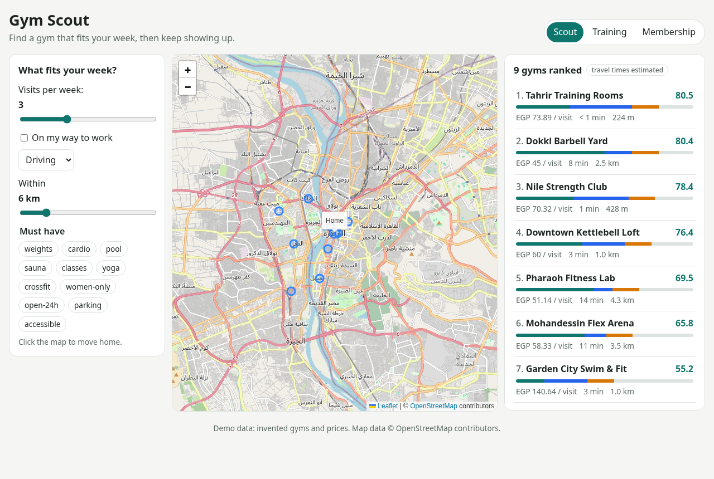
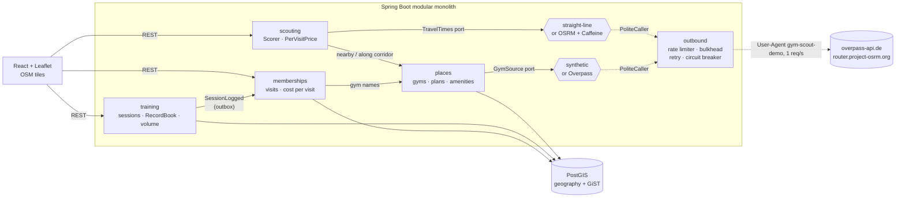

# Gym Scout

**Find gyms near you (or on the way between home and work), compare the real price per visit and the travel time,
then log your workouts and watch your records go up.**

Gym prices are quoted per month, per 3 months, per 12 visits... Gym Scout turns every plan into a price per visit
for how often *you* train, adds how long it takes to get there, and ranks the gyms with a plain-language reason for
each number. Once you join one, it tracks your sessions, personal records, weekly volume and what each visit has
actually cost you so far.

Java 25 · Spring Boot 4.2 · Spring Modulith · PostGIS (geography, GiST, KNN) · Resilience4j · Caffeine ·
React + Vite + Leaflet (OpenStreetMap tiles).



## What it does

- **Scout near a point** – click the map (or use the default point in central Cairo), choose a radius, how many
  times a week you train, walking or driving and the amenities you care about. Results are ordered by score, each
  with the points for price, travel and amenities and a sentence explaining every one of them.
- **Scout along your commute** – drop a home and a work pin; gyms within a corridor around the home↔work line are
  ranked by the detour they add.
- **Price per visit** – for every plan (unlimited or N visits, any duration) the cheapest way to pay for one visit
  at your training frequency.
- **Training log** – sessions with sets (exercise, weight, reps). Personal records are detected on the fly
  (heaviest weight and estimated one-rep max, Epley); the first time you log a lift sets the baseline.
- **Progress** – weekly volume, best lifts, recent records.
- **Membership** – your current plan, visits so far (a session logged at that gym counts as a visit through a
  module event), cost per visit so far and the projected cost per visit at your pace.
- **Live data, off by default** – gyms from the OpenStreetMap Overpass API (`leisure=fitness_centre`) and travel
  times from the public OSRM demo server, behind ports. The default adapters are offline: invented gyms around
  Cairo (names like "Nile Strength Club", made-up prices) and a straight-line travel estimate.

## Architecture

One deployable, cut into Spring Modulith modules with ports and adapters inside each. Modules talk through their
public API or through events stored in Spring Modulith's event publication registry (a transactional outbox).



```
src/main/java/dev/gymscout/
  geo/          shared kernel: GeoPoint, haversine, corridor maths
  outbound/     PoliteCaller: Resilience4j rate limiter + bulkhead + retry + circuit breaker, Micrometer metrics
  places/       domain (Gym, MembershipPlan, amenities) · application (PlacesService, GymRepository, GymSource ports)
                adapter/ persistence (PostGIS KNN) · osm (Overpass + synthetic) · web · demo seeder
  scouting/     domain (Scorer, PerVisitPrice, TravelEstimate, ScoringWeights) · application · adapter/ routing (OSRM) · web
  training/     domain (RecordBook, WeeklyVolume) · application · adapter/ persistence · web · SessionLogged event
  memberships/  domain (CostPerVisit) · application · adapter/ persistence · web
web/            React + Vite + TypeScript, Leaflet map
infra/          Bicep: Container Apps (api + web), Postgres Flexible Server with PostGIS allow-listed
```

## Quickstart

Needs Docker (or Podman) with Compose.

```bash
cp .env.example .env          # optional, placeholders only
docker compose up -d --build --wait
open http://localhost:8091    # web; API docs at http://localhost:8091/api/docs
./scripts/smoke.sh            # health, scout near Cairo, a PR, progress, cost per visit -> "SMOKE PASS"
docker compose down -v
```

Development:

```bash
./mvnw spring-boot:test-run   # API on :8080 against a Testcontainers PostGIS
cd web && npm ci && npm run dev
./mvnw verify                 # Spotless, -Xlint:all -Werror, unit + property + ArchUnit + Modulith + Testcontainers
```

To use live OpenStreetMap data, set `GYMSCOUT_PLACES_SOURCE=overpass` and/or `GYMSCOUT_ROUTING_SOURCE=osrm`, then
`POST /api/places/import` with a point and radius. Be gentle: these are free community servers.

Azure (optional, manual, costs money beyond the free grants; CI only compiles it):

```bash
az bicep build --file infra/main.bicep
az deployment group create -g <resource-group> -f infra/main.bicep -p postgresAdminPassword=<secret> imageRegistry=<registry>
```

## Tests

- **Unit**: scoring, per-visit price, cost per visit, PR replay, weekly volume, amenity tag mapping.
- **Property (jqwik)**: sorting by distance gives non-decreasing distances, distance is symmetric, scores stay
  within 0–100, a gym that is cheaper and closer never scores lower.
- **Architecture**: ArchUnit layering (domain free of Spring and adapters, application never depends on adapters)
  and Spring Modulith `verify()`.
- **WireMock**: the live Overpass and OSRM adapters retry on 429/5xx, the breaker opens, routing falls back to the
  straight-line estimate. Fixtures are hand-written, never recorded from the live servers.
- **Testcontainers PostGIS**: KNN returns the nearest first, the radius filter holds, the full scout → session →
  membership flow.
- **Web**: Vitest for formatting and query building; `scripts/smoke.sh` against the compose stack.

## Design notes / talking points

- **Let the database do geometry.** `geography(Point,4326)` + a GiST index: `ST_DWithin` filters in metres,
  `ORDER BY location <-> :point` is an index-assisted nearest-neighbour scan, `ST_Distance` gives exact metres.
  The commute search builds a line and filters with `ST_DWithin(location, line, :corridor)`. See ADR 0002.
- **Explainable ranking.** The score is relative to the best gym in the result set (cheapest per visit gets all
  50 price points, quickest gets all 35 travel points, 15 for amenities), and each factor carries a sentence.
  Relative scoring stays meaningful whether the radius is 1 km or 20 km.
- **Polite to free APIs.** A `PoliteCaller` wraps every upstream: retry with exponential backoff on 429/5xx,
  outside a 1 request/second rate limiter and a bulkhead of 2, and a circuit breaker that stops calling a struggling server, and
  a fallback (straight-line travel). OSRM answers are cached in Caffeine per rounded origin/destination pair.
  All of it is exported to Micrometer/Prometheus. See ADR 0003.
- **Ports and adapters, offline by default.** Tests, CI and the demo never touch the network; live sources are a
  config switch.
- **Modular monolith.** Spring Modulith verifies module boundaries in a test; `training` publishes
  `SessionLogged`, `memberships` listens. The event publication registry gives at-least-once delivery after a
  crash, and the visit insert is idempotent (`ON CONFLICT (session_id) DO NOTHING`). See ADR 0004.
- **Money as minor units** (`long` piasters) with an explicit currency; no floating-point prices.
- **Records replayed, not stored.** PRs are derived by replaying sets in order (`RecordBook`), so editing history
  never leaves stale records behind.

- **"Today" is a dependency.** Every use case that needs a date gets an injected `java.time.Clock` built from
  `gymscout.zone` (`GYMSCOUT_ZONE`, default `Africa/Cairo`). A session logged at 00:30 Cairo time counts for the
  new day even when the server or CI runner is on UTC, and tests pin the clock instead of sleeping until midnight.

## Interview talking points

- *How do you find the nearest gyms fast?* A GiST index on a `geography` column; `ORDER BY location <-> point`
  is a KNN index scan, `ST_DWithin` keeps the radius filter index-assisted, and a Testcontainers PostGIS test
  proves the order and the radius on a real database.
- *How do you call free third-party APIs without being banned?* One `PoliteCaller` per upstream with a rate
  limiter (1 req/s), bulkhead, retry with backoff only on 429/5xx, a circuit breaker and a fallback, all tested
  with WireMock and exported as metrics; OSRM answers are cached in Caffeine with hit/miss metrics.
- *Microservices or monolith?* A modular monolith: Spring Modulith verifies module boundaries in a test and
  modules talk through events persisted in an outbox, so a module could be split into its own service later
  without changing its callers.
- *How do you keep it explainable?* The score is a sum of three bounded factors, each with a sentence; property
  tests (jqwik) check invariants such as "cheaper and closer never scores lower".
- *A bug you fixed?* Visits logged just after midnight landed on yesterday because the container ran on UTC.
  The fix was not a `TZ` variable but making the zone explicit configuration behind an injected `Clock`.

## Data and attribution

Map tiles and live gym data © [OpenStreetMap](https://www.openstreetmap.org/copyright) contributors, available
under the Open Database License. Travel times in live mode come from the public
[OSRM](https://project-osrm.org/) demo server. The bundled demo gyms, plans and prices are invented.

## Extracted from Lingo

Gym Scout started as a corner of Lingo, a private all-in-one personal assistant: a gym scouting page, a gym
membership tracker and a workout log. This repository is a clean rewrite as a standalone app with a fresh history
and synthetic data only.

## License

MIT, see [LICENSE](LICENSE).
